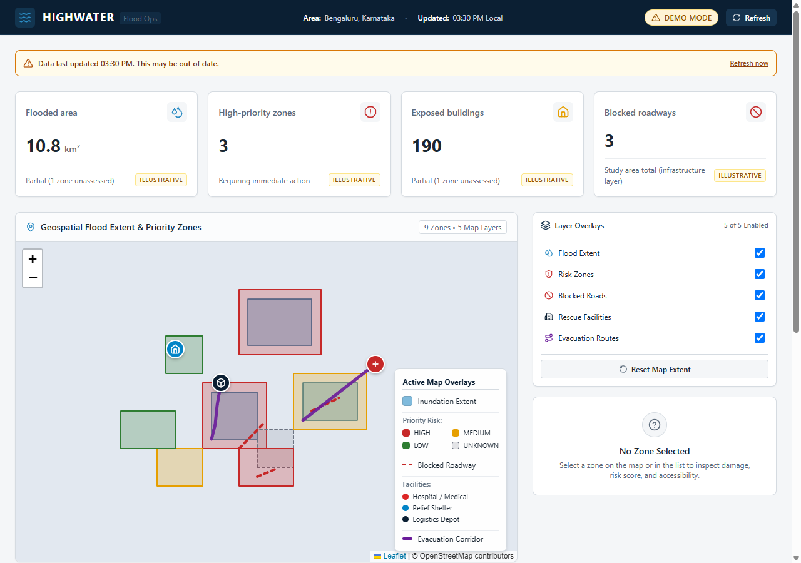
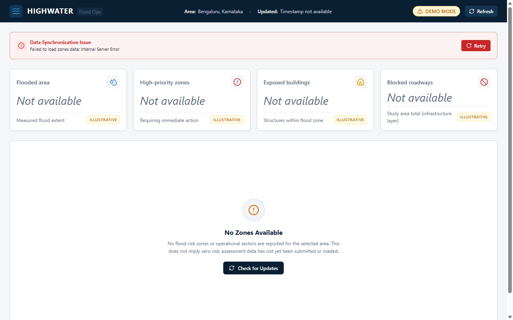
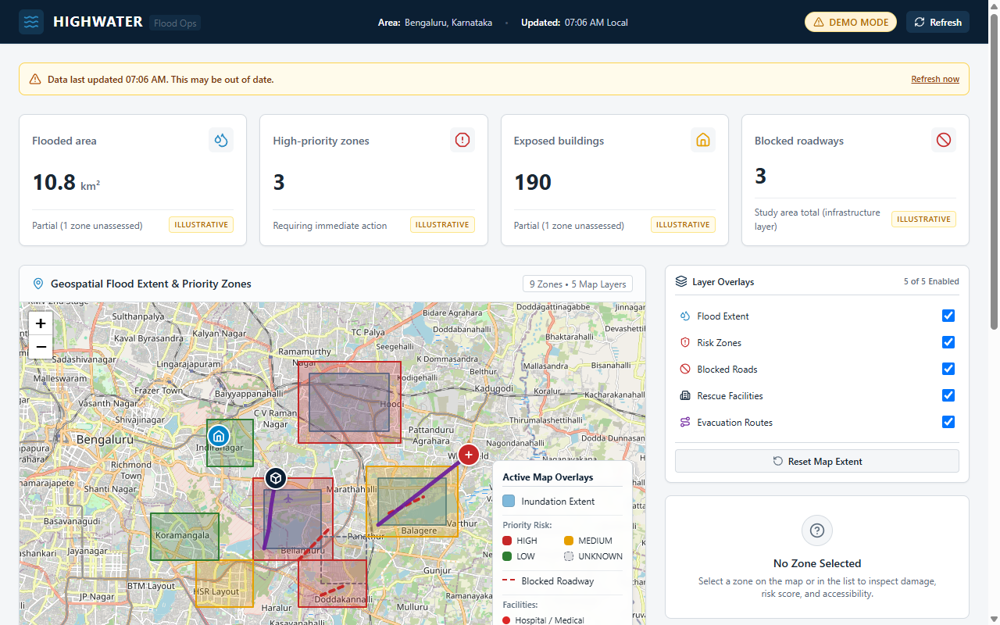
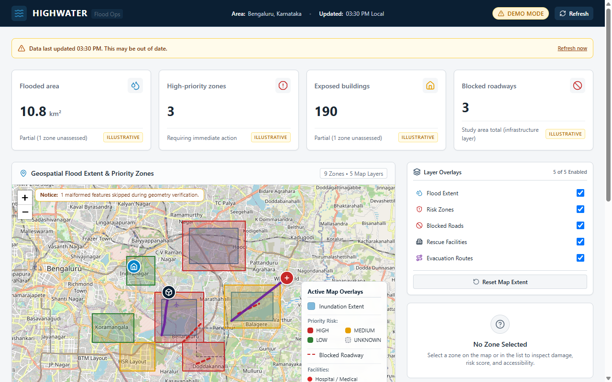
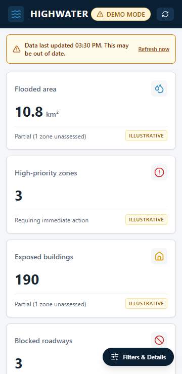
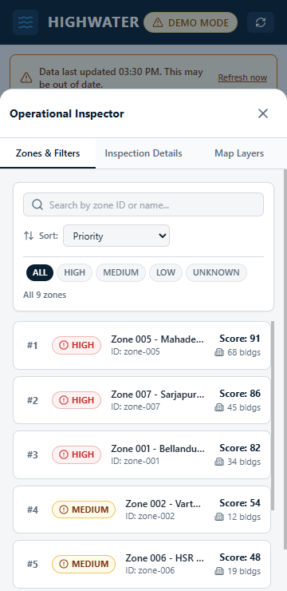

# HighWater — Flood Operations Dashboard (Module: Member 1)

Standalone, responsive, production-ready flood response dashboard engineered for tactical emergency commanders and municipal operations centers. Built with React, Vite, Leaflet, and Tailwind CSS.

---

## 1. Quick Start & Setup

### Prerequisites
- Node.js >= 18
- npm >= 9

### Installation
From the repository root or module directory:
```bash
cd modules/dashboard
npm install
```

### Environment Configuration
Copy `.env.example` to `.env` (optional, defaults provided in code):
```bash
cp .env.example .env
```

Configured environment variables:
| Variable | Default | Purpose |
|---|---|---|
| `VITE_DATA_SOURCE` | `mock` | Data source switcher (`mock` or `api`) |
| `VITE_API_BASE_URL` | `http://localhost:8000/api` | Backend API base URL when in `api` mode |
| `VITE_REFRESH_INTERVAL_MS` | `30000` | Auto-refresh poll interval in milliseconds |
| `VITE_STALE_MINUTES` | `60` | Age threshold for displaying stale-data warning banner |
| `VITE_MAP_TILE_URL` | `https://{s}.tile.openstreetmap.org/{z}/{x}/{y}.png` | Base map tile provider template |

### Running the App
```bash
# Start local development server with HMR
npm run dev

# Build production bundle with Vite
npm run build

# Preview production build locally
npm run preview
```

### Running Tests
```bash
# Run unit and component test suite (Vitest + React Testing Library)
npm test

# Run tests once with coverage report
npm test -- --run --coverage
```

---

## 2. Architecture & Data Contracts

Data path strictly adheres to a unidirectional architecture:
```
Service (dashboardApi) -> Adapter (dataAdapter) -> Hook (useDashboardData) -> Selectors (dashboardSelectors) -> Components
```

### Core Design Rules
- **Layer Isolation**: Components and Leaflet map layers never call `fetch()`. Only `dataAdapter.js` knows backend field names.
- **Data Integrity**: Missing data is never coerced to `0` or `LOW`. Null numeric metrics display as `"Not available"` and are excluded from metric sums. Unknown risk categories normalize strictly to `UNKNOWN` with distinct visual styling.
- **Coordinate System**: All geospatial coordinates conform strictly to GeoJSON RFC 7946: `[longitude, latitude]` in EPSG:4326. Coordinates are automatically converted to Leaflet `[lat, lng]` within layer components.
- **Fault-Tolerant Geometry**: Unclosed rings, coordinate boundary violations, or missing geometries are isolated, logged, and surfaced in the layer warning banner without crashing the application.
- **In-flight Request Guard**: The dashboard prevents duplicate concurrent network fetches during rapid manual refresh clicks.

### Mock Fixtures
Located in `src/mock/`:
- `zones.geojson`: Assessment zones with polygons and attributes (satisfies HIGH, MEDIUM, LOW, UNKNOWN, un-geometried `zone-009`, missing numeric `zone-005`).
- `floodExtent.geojson`: Water depth contours and inundation extents.
- `facilities.geojson`: Critical infrastructure points (hospitals, schools, shelters).
- `blockedRoads.geojson`: Flooded, obstructed, and impassable road line segments.
- `evacuationRoutes.geojson`: Primary and secondary egress corridors with clearance status.

---

## 3. Filter Policy & State Rules

### Filter Scope
| Metric / Component | Follows Active Filter? | Documentation & Rationale |
|---|---|---|
| **Flooded area** | Yes | Sum of inundated hectares across active filtered zones. |
| **High-priority zones** | Yes | Count of filtered zones requiring immediate tactical response. |
| **Exposed buildings** | Yes | Sum of buildings at risk across filtered zones. Nulls excluded. |
| **Blocked roadways** | **No (Infrastructure-wide)** | Infrastructure-wide total from `blockedRoads.geojson`. Not partitioned by zone. |
| **Risk Distribution Chart** | Yes | Category breakdown (HIGH, MEDIUM, LOW, UNKNOWN) for active filtered zones. |
| **Top Impacted Zones Chart** | Yes | Ranked list of filtered zones by risk score. Null scores excluded. |

When a filter is active, stat cards visibly display the contextual badge:
`"Filtered view: N of M zones"`.

---

## 4. State Management & Fallbacks

- **Loading State**: Accessible skeleton cards, animated loading pulse, and non-blocking layout loading screen.
- **Empty State**: Friendly operational prompt when no assessment zones are loaded or query criteria return 0 matches.
- **Error State & Working Retry**: Non-crashing error boundary with descriptive error message and interactive "Retry Request" trigger.
- **Stale Data Banner**: Prominent top alert triggered when payload `generated_at` exceeds `VITE_STALE_MINUTES`.
- **Malformed GeoJSON Resilience**: Catches invalid geometries, syntax errors, or coordinate faults at adapter level; isolates broken layers and presents inline layer alerts while the remaining map operates uninterrupted.
- **Offline Base Map Fallback**: When tile network requests fail or are blocked, the map provides an accessible neutral background (`#e2e8f0`) with an operational notice, preserving interactive vector overlays (flood extents, routes, facilities).
- **Responsive Mobile Drawer & Tablet Layout**: On tablet (640px - 1023px), maintains a 2-column layout with Map and Side Panel side-by-side. On mobile (< 640px), operational controls collapse into a bottom drawer with dedicated tab navigation, preventing horizontal overflow (verified at 360px) and triggering Leaflet `map.invalidateSize()` on drawer toggle.

---

## 5. Manual Map Verification Checklist

1. [x] **Base Map Loading**: OpenStreetMap tiles render smoothly without gray tiles at zoom level 12 (centered on Houston, TX `[29.7604, -95.3698]`).
2. [x] **Layer Toggling**: Check/uncheck each overlay in Layer Controls:
   - Flood Extent (inundation contours)
   - Risk Heatmap (color-coded assessment polygons)
   - Critical Facilities (custom Lucide SVG divIcons for hospitals, schools, shelters)
   - Blocked Roads (red segmented corridors)
   - Evacuation Routes (emerald clear routes, amber degraded routes)
3. [x] **Fault Isolation**: Disabling or breaking one layer does not affect other visible layers or reset map center.
4. [x] **Bidirectional Selection**:
   - Clicking a polygon highlights the zone with an indigo border, opens details, and scrolls the zone row into view.
   - Clicking a list row highlights the zone and flies the map viewport to its bounding box (`map.flyToBounds`).
   - Selecting a non-spatial zone (`zone-009`) updates details cleanly without attempting map pan or throwing exceptions.
5. [x] **Reset Extent**: Clicking "Reset extent" restores default study area coordinates and zoom level.
6. [x] **Keyboard Navigation**: Tab key cycles through layer checkboxes, filter buttons, search input, and zone list rows with visible focus rings.

---

## 6. Screenshot Gallery

All operational states captured from headless Chrome test runs:

### Desktop Views & Operational States
| State | Screenshot |
|---|---|
| **Full Desktop Dashboard (1280px)** |  |
| **Loading State** |  |
| **Empty State** |  |
| **Error State with Retry** |  |
| **Stale Data Banner** |  |
| **Malformed GeoJSON Handling** |  |
| **Offline Tile Fallback** |  |

### Mobile Views (360px Viewport)
| View | Screenshot |
|---|---|
| **Mobile Map View** |  |
| **Mobile Drawer (Controls Open)** |  |

---

## 7. Known Limitations & Module Boundaries

- **Single-module scope**: Member 1 module operates in standalone demonstration mode using validated GeoJSON fixtures. API endpoints in `dashboardApi.js` fall back to mock data when backend services are offline.
- **WebGL / 3D**: Redux, 3D globes, and heavy canvas animation frameworks are deliberately excluded in compliance with hackathon architecture rules to ensure battery-friendly performance on tactical field laptops.
- **Leaflet Marker Icons**: Standard Leaflet PNG markers are replaced with inline Lucide SVG `L.divIcon` to prevent path-resolution issues under Vite asset bundling.

---

## 8. Changelog

- **Phase 1: Setup & Scaffold**:
  - Initialized Vite + React scaffold, Tailwind CSS configuration with centralized `theme.js`.
  - Configured Vitest + React Testing Library with test setup and smoke tests.
- **Phase 2: Layout & Data Foundation**:
  - Implemented mock GeoJSON fixtures meeting all schema and test criteria.
  - Implemented `dataAdapter.js`, `useDashboardData.js`, stat summary cards, and responsive 3-column layout.
- **Phase 3: Interactive Map Layers**:
  - Integrated Leaflet and React Leaflet with custom fault-isolated layer components (`FloodLayer`, `RiskLayer`, `FacilityLayer`, `RoadLayer`, `RouteLayer`).
  - Added extent controls, layer toggle panel, and divIcon markers.
- **Phase 4: State Wiring & Bidirectional Interaction**:
  - Wired bidirectional selection between polygon clicks and list rows.
  - Added `ZoneSearch`, `ZoneFilter`, `ZoneList`, `ZoneDetails`, `RiskDistributionChart`, and `ImpactChart`.
  - Established filter policy and verified in-flight request deduplication.
- **Phase 5: Test, Polish & Resilience**:
  - Implemented `LoadingState`, `EmptyState`, and `ErrorState` with retry callback.
  - Added `StaleBanner` for data freshness alerts.
  - Added malformed GeoJSON handling and offline tile fallback.
  - Implemented mobile bottom drawer with tab switcher and `map.invalidateSize()` resize handler.
  - Completed accessibility pass (ARIA attributes, 2px focus ring, high-contrast risk labels).
